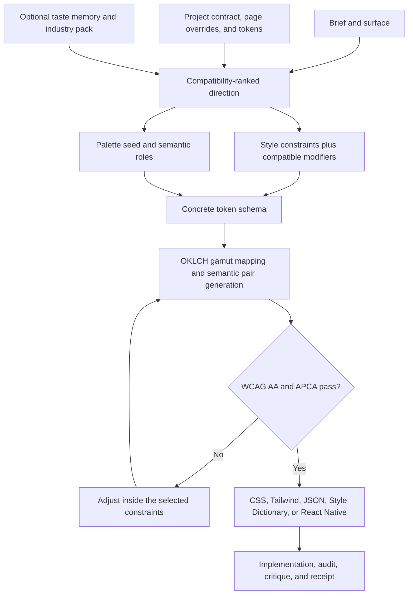

# Kinetic UI UX Pro

[](https://github.com/mSolstice/Kinetic-UI-UX-Pro/actions/workflows/ui-audit.yml)
[](LICENSE)
[](requirements.txt)

Kinetic UI UX Pro is a constraint-driven UI/UX engineering skill for Codex and Claude Code. It turns a product brief into an implemented interface, a verified design system, an accessibility-aware state model, and a measured delivery receipt.

It is not a theme pack or a runtime component library. It is an agent instruction system plus deterministic Python tools that make design decisions inspectable, repeatable, and testable.

It is designed for fast generation of landing pages, dashboards, and product UI without sacrificing a coherent visual system. Project decisions persist across sessions and pages instead of being re-derived every time the agent starts.

## Why Kinetic Exists

Prompt-only UI generation can make a convincing first screen while quietly inventing tokens, omitting failure states, flattening hierarchy, or treating accessibility as a final checklist. Kinetic handles those concerns as one system: intent, information architecture, content, visual direction, interaction state, motion, tokens, accessibility, and verification.

| Prompt-only UI guidance | Kinetic UI UX Pro |
| --- | --- |
| Chooses a look from adjectives | Ranks compatible styles and palettes, then states the tradeoff |
| Emits literal colors and spacing | Derives semantic tokens from constraints and verifies them before emission |
| Optimizes the populated happy path | Requires applicable loading, disabled, error, success, empty, and focus states |
| Re-derives taste every session | Reads a project contract and can apply explicit, inspectable taste memory |
| Treats accessibility as prose | Runs structural audits, contrast math, token-drift checks, and CI gates |
| Produces one unexplained direction | Can generate mechanically divergent variants and record accepted or rejected traits |
| Ends with "looks good" | Reports what was measured, what remains manual, and what could not be verified |

## What It Can Do

- Frame the user job, actors, pressure, real-world states, and success signal before markup.
- Rapidly establish coherent visual direction for landing pages, dashboards, settings, onboarding, checkout, and other product surfaces.
- Recommend a visual style, palette, density, motion budget, and industry reasoning pack from a brief.
- Generate semantic design tokens for CSS, Tailwind, JSON, Style Dictionary, and React Native.
- Verify light and dark semantic color pairs with WCAG 2.x AA and APCA before tokens ship.
- Build or adapt components around a nine-state interaction matrix and native accessibility semantics.
- Search approved design-system values and flag hardcoded color, spacing, radius, type, and motion drift.
- Audit HTML, CSS, JavaScript, TypeScript, JSX/TSX, Svelte, Vue, Astro, React Native, and Expo-oriented code.
- Preserve settled decisions, superseded choices, rejected directions, component provenance, and open questions.
- Translate feedback such as "less corporate" or "more breathing room" into bounded, verified token deltas.
- Generate hostile content fixtures for long text, RTL, localization, missing values, and realistic empty states.
- Produce CI output in SARIF or JUnit and a plain-language HTML or Markdown stakeholder handoff.

## Evidence, Not Just Advice

The repository currently includes:

| System | Verified inventory |
| --- | ---: |
| Visual style constraint sets | 12 |
| Composable style modifiers | 8 |
| Valid base-style and modifier combinations | 90 |
| Mood-organized, dual-gate verified palette seeds | 208 |
| Industry reasoning rules across 10 domains | 190 |
| Licensed component-library adapters | 8 |
| State-complete component scaffolds | 7 |
| Pre-mapped UX flow specifications | 5 |

Palette seeds store hue, chroma, relationship, and mood rather than fixed hex palettes. Style files define ranges, ratios, and prohibitions rather than shipping a frozen visual preset.

## Visual Style, Typography, and Color Assets

Kinetic includes a searchable visual-direction library rather than a collection of screenshots or frozen themes:

- **12 visual styles:** editorial, brutalist, swiss-grid, soft-neumorphic, glass-layered, technical-dense, warm-organic, high-contrast-utility, retro-terminal, luxury-minimal, playful-rounded, and data-forward.
- **8 composable modifiers:** dense, airy, mono, duotone, bordered, elevated, sharp, and rounded. Compatibility rules reject combinations that would break a style's identity.
- **Typography constraints:** each style controls type-scale ratio, weight range, tracking, case treatment, and maximum font families. Font metric tooling computes real fallback overrides instead of inventing them.
- **208 verified color seeds:** palettes span 12 moods and store perceptual hue/chroma relationships rather than hardcoded ramps. Semantic light and dark tokens are generated in OKLCH, gamut-mapped, and checked with WCAG AA plus APCA.
- **Interoperability:** token output supports CSS custom properties, Tailwind, JSON, Style Dictionary, and typed React Native modules; Radix Colors can be imported or used as a comparison benchmark.

The repository intentionally does not bundle font binaries or redistribution-restricted visual assets. It provides the constraints, generation logic, and verification needed to use approved assets coherently.

## Persistent Design-System Source of Truth

Each project can keep `design-system/contract.json` as its durable source of truth. It records the chosen style and modifiers, palette, typography scale, density, motion budget, token-file hash, components, rejected directions, rationales, and open questions.

Project decisions apply everywhere by default. Named pages can record explicit overrides with their own rationale and supersession history; `ds_contract.py read --page <id>` returns the effective merged decisions in under 40 lines for reliable loading at the start of a later session. Global taste memory is separate and optional: it can bias a new project from prior evidence, but it never overrides the current brief or accessibility constraints.

## What It Cannot Do

- It does not bundle a browser. Visual critique runs only when Playwright and a working browser binary are available.
- Static analysis cannot prove rendered geometry, runtime focus order, assistive-technology behavior, or visual-regression safety.
- Automated checks do not replace manual keyboard, screen-reader, touch, zoom, and device testing.
- Contrast checks verify declared and detected color pairs; they cannot know every runtime compositing or image-background condition.
- Industry and compliance packs are orientation, not legal advice or certification. Jurisdiction-specific requirements need qualified review.
- It does not generate product research, business rules, backend behavior, production copy, or brand assets that were not supplied.
- It never treats paid or redistribution-restricted component source as vendorable.

## How It Works for a User

1. **Install once.** Add the repository as a Codex skill or Claude Code plugin and install the optional Python dependencies.
2. **Ask naturally.** Prompts can be specific ("build an async customer combobox") or subjective ("make this dashboard feel less corporate").
3. **Load project memory.** If `design-system/contract.json` exists, Kinetic reads settled project decisions plus any page-specific overrides instead of re-inventing them.
4. **Frame the task.** It infers the job, audience, operating pressure, state space, and success signal from the brief and codebase. It asks only when a missing answer would materially change the architecture or risk.
5. **Choose a direction.** It respects an explicit preference, recommends a compatible style and palette, or generates divergent options for an open brief.
6. **Generate the system.** Constraint ranges become semantic tokens. The generator verifies contrast and retries within the selected style rather than emitting a failing schema.
7. **Build in the existing stack.** Kinetic follows project conventions, searches approved registries before reimplementing common components, and records adapted-source provenance.
8. **Exercise the edges.** Empty, loading, error, disabled, success, localization, reduced-motion, responsive, and hostile-content cases are handled alongside the happy path.
9. **Verify before delivery.** Structural audit, token conformance, design self-critique, and relevant domain checks run before the final response.
10. **Leave durable decisions.** The compact engineering receipt reports measured results; larger systems can also produce a stakeholder handoff.

Example prompts:

```text
Use Kinetic UI UX Pro to build a filterable operations table for warehouse staff on shared tablets.

Give me three genuinely different directions for a healthcare onboarding flow, then explain the tradeoff in each.

Make this settings page feel warmer and less corporate without changing its information architecture.

Audit this React Native checkout flow for accessibility, token drift, state coverage, and touch targets.
```

## How Design-System Generation Works



The important distinction is the verification loop:

- `design_select.py` ranks style, palette, and industry candidates and names what the top choice sacrifices.
- `style_apply.py` composes a base style with compatible modifiers and derives concrete values inside their allowed ranges.
- `token_gen.py` computes ramps in OKLCH, gamut-maps them to sRGB, and verifies semantic pairs with both contrast gates.
- A failing attempt is adjusted within the same constraint set, up to five attempts. A schema that still fails is not emitted.
- The resulting tokens can be indexed so later code reuses approved values instead of inventing new ones.

## Installation

Minimum Python version: 3.9. Most scripts use the standard library; parsing, font metrics, and rendered critique have optional dependencies in `requirements.txt`.

### Codex

Clone the skill into the local Codex skills directory:

```bash
git clone https://github.com/mSolstice/Kinetic-UI-UX-Pro.git ~/.codex/skills/kinetic-ui-ux-pro
cd ~/.codex/skills/kinetic-ui-ux-pro
python -m venv .venv
source .venv/bin/activate
pip install -r requirements.txt
```

Start a new Codex task and invoke `$kinetic-ui-ux-pro`, or ask for frontend/UI work that matches the skill trigger. The canonical entry point is `SKILL.md`.

### Claude Code

The Claude-native manifest is `.claude-plugin/plugin.json`; its wrapper skill is `skills/kinetic-ui-ux-pro/SKILL.md`.

```bash
mkdir -p ~/.claude/skills
git clone https://github.com/mSolstice/Kinetic-UI-UX-Pro.git ~/.claude/skills/kinetic-ui-ux-pro
cd ~/.claude/skills/kinetic-ui-ux-pro
python -m venv .venv
source .venv/bin/activate
pip install -r requirements.txt
claude plugin validate . --strict
```

Restart Claude Code or run `/reload-plugins`, then invoke `kinetic-ui-ux-pro@skills-dir`.

### ChatGPT Distribution Status

The repository contains the skill and plugin assets needed for Codex and Claude Code use. Public listing in ChatGPT's Plugins Directory is a separate submission and review step; cloning this repository does not itself create a public ChatGPT installation.

## Repository Map

```text
SKILL.md                         Canonical workflow and enforcement contract
skills/kinetic-ui-ux-pro/       Claude Code path-resolution wrapper
.claude-plugin/                 Claude Code plugin manifest
scripts/                        Deterministic generators, search, audit, and handoff tools
references/                     Progressive-disclosure design and engineering guidance
templates/                      Tokens, styles, palettes, adapters, patterns, flows, and receipts
codex/evals/                    Manual-paste behavior evaluation harness
.github/workflows/              Pull-request verification and SARIF upload
```

The Python files remain in `scripts/` because they are executable implementation, not README content. The root page intentionally shows capability groups; the complete command catalog lives in [docs/tooling.md](docs/tooling.md).

## Verification Layers

| Layer | What is checked |
| --- | --- |
| Design tokens | Deterministic output, gamut mapping, WCAG AA, APCA, light/dark semantic pairs |
| Design-system conformance | Hardcoded value extraction, nearest approved token, recurring drift |
| Structure and accessibility | Element semantics, labels, focus patterns, state heuristics, framework-specific risks |
| Responsive behavior | Breakpoint quality, declared responsive intent, unsupported ranges, hidden-content disagreement |
| Content resilience | Long strings, RTL, locale formats, missing optional values, empty-state coverage |
| Design quality | Spacing and type rhythm, hierarchy, alignment, density, radius/shadow consistency, accent overuse |
| Provenance and licensing | Allowlisted SPDX licenses, attribution notices, vendoring policy, source-library record |
| CI | Python compilation, dependency integrity, vulnerability audit, token verification, palettes, rules, SARIF |

See [docs/tooling.md](docs/tooling.md) for commands and [templates/receipt.md](templates/receipt.md) for the measured delivery contract.

## Licensing and Component Policy

Kinetic UI UX Pro is MIT licensed. External library guidance is limited to MIT, Apache-2.0, or ISC sources in the master adapter contract. Registry synchronization stores metadata and URLs only; component source is fetched into a temporary directory when adaptation is requested, and redistribution is refused when the adapter does not permit it.

See [references/kinetic-ui-ux-pro.md](references/kinetic-ui-ux-pro.md) for the approved library contract.

## License

MIT. See [LICENSE](LICENSE).
